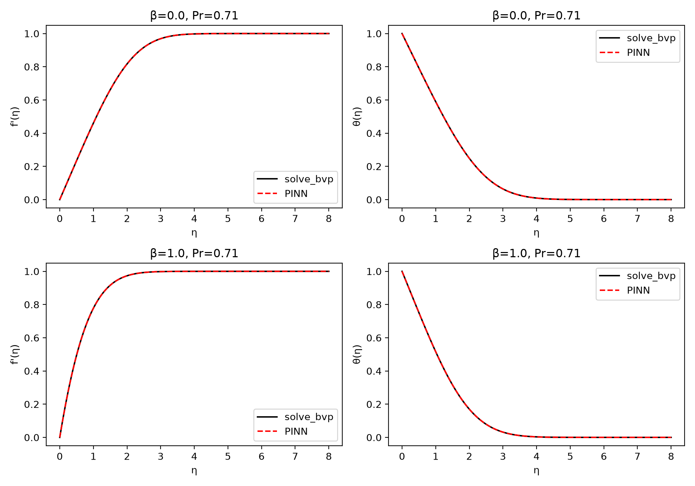
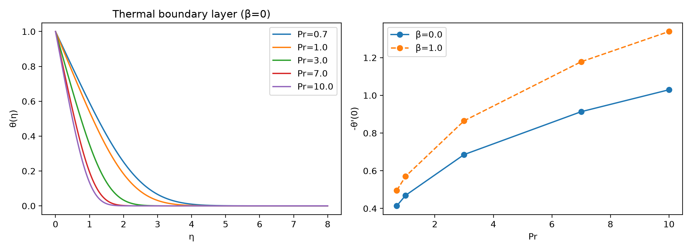

# falkner-skan-pinn
# Falkner-Skan Flow with Heat Transfer: PINN vs Classical Solver

Solves the Falkner-Skan boundary-layer equations with a passive temperature
field using (1) SciPy's `solve_bvp` and (2) a physics-informed neural network
in PyTorch, then compares them.

## Equations
f''' + f f'' + β(1 − f'²) = 0,  θ'' + Pr f θ' = 0
f(0)=0, f'(0)=0, f'(∞)=1, θ(0)=1, θ(∞)=0

## Run
pip install -r requirements.txt
python run_comparison.py
python prandtl_study.py

## Validation
Known values: f''(0) ≈ 0.4696 (β=0), ≈ 1.2326 (β=1).

## Results

## Validation results

| β | Quantity | solve_bvp | PINN | Error % |
|---|----------|-----------|------|---------|
| 0.0 | f''(0) | 0.46960 | 0.46959 | 0.00 |
| 0.0 | -θ'(0) | 0.41601 | 0.41592 | 0.02 |
| 1.0 | f''(0) | 1.23259 | 1.23252 | 0.01 |
| 1.0 | -θ'(0) | 0.49866 | 0.49861 | 0.01 |

Parameters: Pr = 0.71, L = 8, 6000 Adam + 300 L-BFGS iterations.
## References
- V. M. Falkner and S. W. Skan, Phil. Mag. 12 (1931) 865.
- M. Raissi, P. Perdikaris, G. E. Karniadakis, J. Comput. Phys. 378 (2019).

## Possible extensions
Magnetic (MHD) term, viscous dissipation, weak-form loss.
